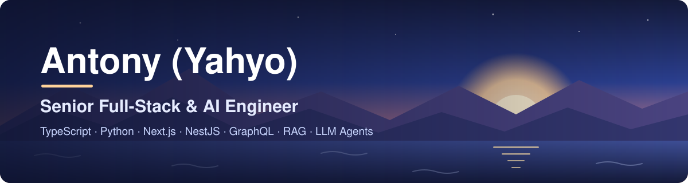

  

  
  
  

## 👋 About me

Senior full-stack and AI engineer with **3+ years of experience** building and deploying production web platforms and AI-powered features in **TypeScript** and **Python**. I work across the full product lifecycle — data modelling, GraphQL and REST APIs, Next.js interfaces, Linux servers and CI/CD — with a focus on applied AI: **RAG**, **LLM integrations** and **model fine-tuning**.

- 📍 Based in **South Korea** (Busan / Seoul) · originally from Uzbekistan
- 🌐 Languages: English · Korean
- 💼 Open to **full-stack and AI engineer** roles

## 🚀 Featured projects

| Project | What it is | Stack |
| --- | --- | --- |
| **[MedVia](https://github.com/yakhyo018/MedVia)** · [live](https://medvia.tech) | Medical-tourism platform: book Seoul clinics in your own language, with translated real-time chat and AI features. Built and deployed end to end. | Next.js · NestJS · GraphQL · MongoDB · Redis · Socket.IO · Docker |
| **[MedVia Navi](https://github.com/yakhyo018/MedVia-Navi-RAG)** | RAG service that answers only from MedVia's own content, cites sources `[1] [2]` and refuses when it doesn't know. LoRA fine-tuned Qwen, evaluated on a held-out set. | FastAPI · Qdrant · multilingual-e5 · Qwen2.5 · LoRA |
| **[PocketGPT](https://github.com/yakhyo018/Pocket-GPT)** | ChatGPT-like chat whose model runs on your own computer: Qwen2.5-1.5B fine-tuned with QLoRA for English, Russian and Uzbek, served as a 1 GB GGUF. | FastAPI · llama.cpp · Next.js · SQLite · QLoRA |
| **[NextGain](https://github.com/yakhyo018/NextGain-react)** · [live](https://nextgain.shop) | Sports-nutrition store with cart, orders and an owner admin panel. | React · Redux Toolkit · Express · MongoDB · EJS |

## 🛠️ Tech stack

**Languages**

**AI / ML**

**Frontend**

**Backend**

**Data & DevOps**

## 📫 Contact

- ✉️ **Email:** [choriyevyahyo@gmail.com](mailto:choriyevyahyo@gmail.com)
- 🌐 **Live projects:** [medvia.tech](https://medvia.tech) · [nextgain.shop](https://nextgain.shop)
